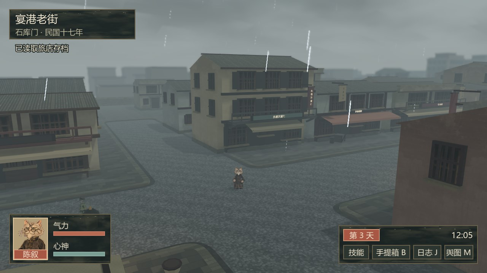
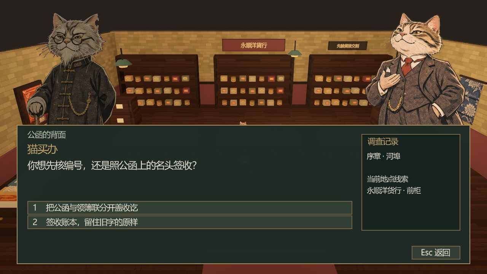
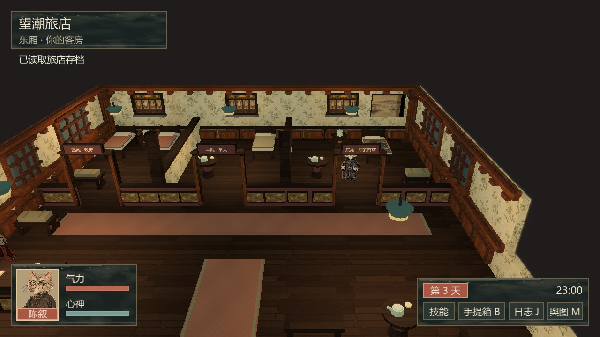
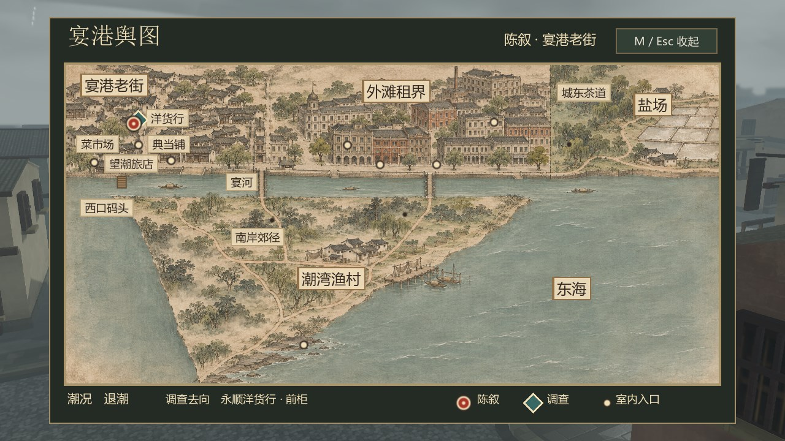

# 缄默之潮 · Silent Tide

**民国十七年，宴港。你还没下船，岸上已经有人替你签了名。**

**[下载 v0.11.1 · Windows x64 安装包](https://github.com/lzhhhhh-bot/silent-tide/releases/download/v0.11.1/SilentTide-0.11.1-Setup.exe)** · [查看更新记录](https://github.com/lzhhhhh-bot/silent-tide/releases)

## 一张昨夜签收的领单

账房陈叙受托来宴港清一笔三十年前的盐货款。公函刚递进永顺洋货行，猫买办便从簿底翻出一张昨夜送来的领单。上头是陈叙的名字，可他的船今早才靠岸。

沿骑楼走到望潮旅店，从鱼摊打听船次，再到潮湾晒网场找认得旧绳结的人。有人只肯说自己亲眼见到的半截话，有人还记得一张凳子该留给谁坐，却喊不出那个人的名字。

## 你会怎样问下去？

- **走进街坊的日常。** 在菜场、货栈和渔码头找人，也能去旅店、洋货行、典当铺和外滩的室内场景。舆图标出陈叙的位置，走访后才显露当地的建筑名称。
- **用自己的本事问话。** 盘账能让经手人把两笔钱说清，周旋能让人自己讲下去。一些关键问话有不同技能解法。检定失手可能扣气力、改变会面地点或对方愿意说的内容。
- **决定你愿意把谁写进账里。** 游戏没有战斗，以探索、对话和受 CoC 启发的百分骰检定推进。序章与六章主线通向五种结局，各有尾声。

## 宴港实机

<table>
  <tr>
    <td width="50%"> <strong>宴港老街</strong> · 沿骑楼认铺号</td>
    <td width="50%"> <strong>永顺洋货行</strong> · 问公函是谁签的</td>
  </tr>
  <tr>
    <td width="50%"> <strong>望潮旅店</strong> · 住一夜，再去问话</td>
    <td width="50%"> <strong>宴港舆图</strong> · 记下走过的街</td>
  </tr>
</table>

## 安装与操作

下载安装包并运行，在「选择目标位置」页点「浏览」即可更改安装目录。存档保存在当前 Windows 用户目录。

| 操作 | 按键 |
| --- | --- |
| 移动 / 调查或交谈 | WASD 或方向键 / E |
| 手提箱 / 日志 / 舆图 | B / J / M |
| 对话选择 / 返回 | 数字键 / Esc |

v0.11.1 点击「新游戏」直接进入开场。确认登岸后使用第一个空存档栏。十栏都满时，会覆盖最后一次保存时间最早的一栏。

这是游戏发行仓库。安装包和版本说明见 [Releases](https://github.com/lzhhhhh-bot/silent-tide/releases)，第三方许可附在安装目录的 Licenses 文件夹中。
